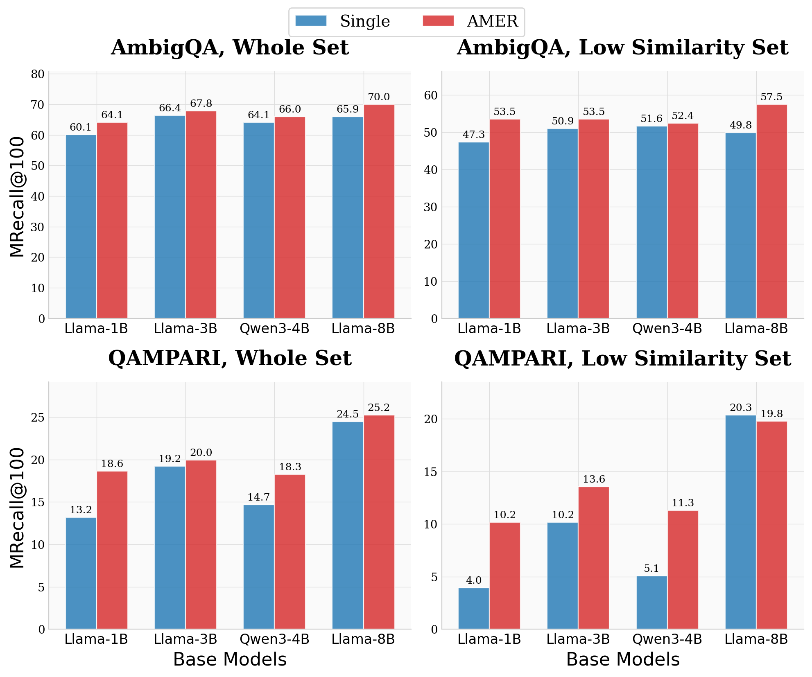
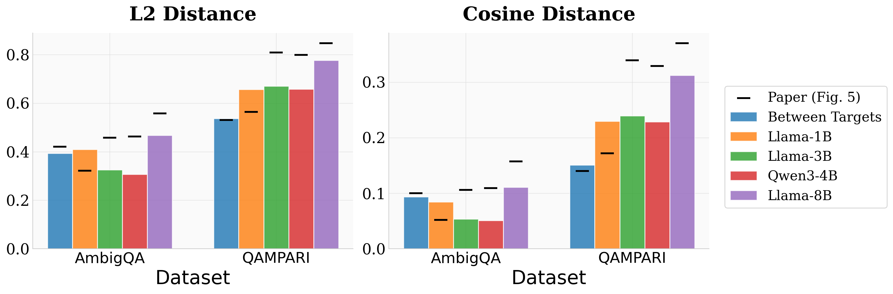

# Paper reproduction with the fixes: results (2026-10-28)

Code: paper stack `fe0bd78` + data/eval fixes, branch `paper-repro`. Plan, recipe and the full status log: `PLAN.md` in this folder.
24 runs = 4 LMs × {AmbigQA, QAMPARI} × {single-query, AMER (scheduled sampling), always-predicted}. All 24 trained 120/120 epochs and were scored.

## Answer

- **AmbigQA reproduces.**
  - AMER beats single-query for every LM: +1.5 to +4.1 MRecall@100.
  - The gain is significant for all 4 LMs on the full corpus (3B only with RR).
  - On the paper's own old index, the numbers match Tables 7–10 within about 1–3 points, including the low-sim gains.
- **QAMPARI only partly reproduces.**
  - With RRF, AMER ≥ single for all 4 LMs. The gain is significant only for 1B (p ≤ .015) and for 8B with RRF (p = .04).
  - 3B shows no gain (RRF +0.4, RR −1.1).
  - The large low-sim gains reported for 1B/3B/Qwen do not reproduce on the old index: 1B +1.1 vs paper +3.6 points, 3B +0.6 vs +4.7.
- **The paper's QAMPARI absolute numbers are inflated by the test leak.**
  - The paper's 8B checkpoints score 84–91% on the 44 leaked test questions; ours score 11–18%.
  - On the 487 clean questions, ours match the paper checkpoints within seed noise (8B single 25.67 vs 26.49; AMER RRF 27.52 vs 28.00).
- **Our AMER embeddings are less diverse than the paper's on QAMPARI for 3B and 8B** (pairwise cosine 0.82 / 0.75 vs 0.66 / 0.63).
  - For 1B they match (0.85 vs 0.83). 1B is also the only LM whose paper batch (32 × 4) is close to ours (50 × 2).
  - Candidate causes:
    - `sample_rate_multiplier` 1 vs the paper's 10;
    - batch size, which also means about 3.5× fewer steps for 3B/8B.
  - Multiplier 10 (see its section) lowers the cosine for every model by 0.06–0.08 and improves QAMPARI AMER RRF for 1B (+1.7, p = .05) and Qwen (+1.7, p = .08), but not 3B (+0.4) or 8B (−1.5). Only 1B reaches the paper's diversity.
- **Always-predicted (`--force_sampling`) is the weaker variant.**
  - It is never significant on AmbigQA.
  - On QAMPARI it hurts 3B and 8B, but is the best run for Qwen.

## What differs from the paper

- Fixes:
  - stripped QAMPARI gold whitespace and re-embedded the golds;
  - removed train near-duplicates of test questions (QAMPARI −106 train q / 44 test q, Jaccard ≥ 0.8 on gold ids; AmbigQA −67, exact normalized question);
  - seeded negatives;
  - full 25.86M index (old 21M index also reported).
- Recipe choices (user):
  - batch 50/GPU × 2 GPUs, vs the paper's QAMPARI 8 × 4 (1B 32 × 4) and AmbigQA 32 × 4;
  - `sample_rate_multiplier` 1 (paper QAMPARI 10);
  - one seed;
  - RR and RRF (k = 60).
- Kept faithful:
  - `mix_one_label_shuffled` extra step;
  - lr, epochs, LoRA, loss;
  - dev-loss checkpoint selection;
  - eval-mode training (fe0bd78 never calls `model.train()`, so LoRA dropout is never active).
- Memory only (same math): per-layer activation checkpointing, KV cache off.

## Results (MRecall@100; one seed)

"Low-sim" is the paper's low-similarity third of the test set: QAMPARI 177 q (1 q = 0.56 pt), AmbigQA 275 q.
The p-value is a one-sided paired bootstrap (10k resamples) of AMER minus single, on the full index over all questions.
"Clean 487" excludes the 44 leaked QAMPARI test questions.

### ambiguous_qe

| Model | Run | Full: all | Full: low-sim | Old 21M: all | Old 21M: low-sim | p vs single (full, all) |
|---|---|---|---|---|---|---|
| Llama-1B | Single | 60.10 | 47.27 | 57.80 | 45.82 | — |
| Llama-1B | AMER RR | 63.72 | 52.36 | 60.94 | 50.91 | 0.000 |
| Llama-1B | AMER RRF | 64.09 | 53.45 | 61.06 | 50.55 | 0.000 |
| Llama-1B | Always-pred RR | 61.43 | 49.82 | 57.92 | 45.82 | 0.110 |
| Llama-1B | Always-pred RRF | 61.43 | 48.73 | 58.04 | 45.09 | 0.097 |
| Llama-3B | Single | 66.38 | 50.91 | 62.64 | 49.45 | — |
| Llama-3B | AMER RR | 68.20 | 54.18 | 65.54 | 52.73 | 0.031 |
| Llama-3B | AMER RRF | 67.84 | 53.45 | 65.18 | 52.00 | 0.075 |
| Llama-3B | Always-pred RR | 65.78 | 50.91 | 62.76 | 48.73 | 0.757 |
| Llama-3B | Always-pred RRF | 65.66 | 50.18 | 62.27 | 48.36 | 0.802 |
| Qwen3-4B | Single | 64.09 | 51.64 | 59.37 | 47.64 | — |
| Qwen3-4B | AMER RR | 65.90 | 53.82 | 62.52 | 50.18 | 0.025 |
| Qwen3-4B | AMER RRF | 66.02 | 52.36 | 62.76 | 50.18 | 0.023 |
| Qwen3-4B | Always-pred RR | 65.66 | 50.55 | 62.15 | 49.09 | 0.065 |
| Qwen3-4B | Always-pred RRF | 64.93 | 50.18 | 62.27 | 49.09 | 0.215 |
| Llama-8B | Single | 65.90 | 49.82 | 61.67 | 46.55 | — |
| Llama-8B | AMER RR | 69.89 | 56.36 | 66.63 | 54.91 | 0.000 |
| Llama-8B | AMER RRF | 70.01 | 57.45 | 66.14 | 53.82 | 0.000 |
| Llama-8B | Always-pred RR | 67.35 | 51.64 | 63.60 | 49.09 | 0.067 |
| Llama-8B | Always-pred RRF | 67.23 | 51.64 | 63.12 | 49.45 | 0.088 |

### qampari

| Model | Run | Full: all | Full: low-sim | Full: clean 487 | Old 21M: all | Old 21M: low-sim | p vs single (full, all) |
|---|---|---|---|---|---|---|---|
| Llama-1B | Single | 13.18 | 3.95 | 13.55 | 6.03 | 1.13 | — |
| Llama-1B | AMER RR | 16.01 | 8.47 | 16.43 | 7.34 | 2.26 | 0.015 |
| Llama-1B | AMER RRF | 16.95 | 8.47 | 17.45 | 7.72 | 2.82 | 0.001 |
| Llama-1B | Always-pred RR | 14.69 | 8.47 | 15.40 | 5.46 | 3.39 | 0.141 |
| Llama-1B | Always-pred RRF | 13.94 | 6.78 | 14.58 | 6.40 | 3.39 | 0.292 |
| Llama-3B | Single | 19.21 | 10.17 | 18.89 | 7.53 | 3.95 | — |
| Llama-3B | AMER RR | 18.08 | 12.43 | 18.48 | 7.53 | 4.52 | 0.822 |
| Llama-3B | AMER RRF | 19.59 | 12.99 | 19.92 | 8.29 | 4.52 | 0.405 |
| Llama-3B | Always-pred RR | 16.76 | 9.60 | 17.45 | 7.53 | 3.39 | 0.963 |
| Llama-3B | Always-pred RRF | 18.27 | 10.17 | 18.89 | 6.40 | 2.82 | 0.782 |
| Qwen3-4B | Single | 14.69 | 5.08 | 15.40 | 5.65 | 2.82 | — |
| Qwen3-4B | AMER RR | 16.01 | 10.73 | 16.22 | 7.16 | 3.95 | 0.176 |
| Qwen3-4B | AMER RRF | 16.57 | 11.30 | 16.84 | 7.34 | 3.95 | 0.078 |
| Qwen3-4B | Always-pred RR | 16.76 | 10.17 | 17.45 | 7.16 | 5.08 | 0.059 |
| Qwen3-4B | Always-pred RRF | 17.51 | 8.47 | 18.28 | 7.72 | 4.52 | 0.008 |
| Llama-8B | Single | 24.48 | 20.34 | 25.67 | 9.79 | 5.65 | — |
| Llama-8B | AMER RR | 25.99 | 20.90 | 26.69 | 9.60 | 6.21 | 0.131 |
| Llama-8B | AMER RRF | 26.74 | 20.34 | 27.52 | 9.79 | 6.21 | 0.040 |
| Llama-8B | Always-pred RR | 22.60 | 18.08 | 23.82 | 9.42 | 6.21 | 0.950 |
| Llama-8B | Always-pred RRF | 22.79 | 14.12 | 23.61 | 9.42 | 5.08 | 0.924 |

## Against the paper (old 21M index, RR; paper = 3-seed mean, Tables 7–10)

All / low-sim, single → AMER (scheduled sampling):

| | Paper AmbigQA | Repro AmbigQA | Paper QAMPARI | Repro QAMPARI |
|---|---|---|---|---|
| Llama-1B | 58.57/46.06 → 60.94/49.33 | 57.80/45.82 → 60.94/50.91 | 6.53/1.50 → 8.41/5.08 | 6.03/1.13 → 7.34/2.26 |
| Llama-3B | 62.80/49.33 → 65.06/51.64 | 62.64/49.45 → 65.54/52.73 | 8.53/2.82 → 10.55/7.53 | 7.53/3.95 → 7.53/4.52 |
| Qwen3-4B | 61.79/48.85 → 63.81/50.43 | 59.37/47.64 → 62.52/50.18 | 6.40/2.44 → 8.41/6.59 | 5.65/2.82 → 7.16/3.95 |
| Llama-8B | 62.64/49.58 → 66.26/52.00 | 61.67/46.55 → 66.63/54.91 | 11.68/8.47 → 11.86/8.85 | 9.79/5.65 → 9.60/6.21 |

The paper's QAMPARI numbers include the 44 leaked test questions; 14 of them are in the low-sim set.

## QAMPARI leak (8B, full index, MRecall@100)

| | All 531 | Clean 487 | Leaked 44 |
|---|---|---|---|
| Paper ckpt single (3 seeds) | 31.45 / — / — | 26.49 / 25.87 / 27.10 | 86.4 (each seed) |
| Paper ckpt AMER RRF (3 seeds) | 31.64 / 32.20 / 34.09 | 26.90 / 27.52 / 29.57 | 84.1 (each seed) |
| Repro single | 24.48 | 25.67 | 11.4 |
| Repro AMER RRF | 26.74 | 27.52 | 18.2 |

## Output-embedding diversity (mean pairwise cosine; lower = more diverse)

Paper values are the Fig. 5 numbers hard-coded in `plot_output_similarity.py` @fe0bd78. 3-seed rows = headline AMER runs (mean ± sd, seeds 0–2; QAMPARI multiplier 10). Seed-0 rows = original multiplier-1 scheduled-sampling runs, always-predicted in brackets.

| | Target golds | 1B | 3B | Qwen3-4B | 8B |
|---|---|---|---|---|---|
| QAMPARI paper | 0.86 | 0.828 | 0.661 | 0.671 | 0.63 |
| QAMPARI repro, 3 seeds (mult. 10) | | 0.772 ± .005 | 0.763 ± .013 | 0.767 ± .005 | 0.691 ± .003 |
| QAMPARI repro, seed 0 (mult. 1) | | 0.849 (0.636) | 0.820 (0.658) | 0.835 (0.697) | 0.749 (0.595) |
| AmbigQA paper | 0.90 | 0.948 | 0.894 | 0.891 | 0.843 |
| AmbigQA repro, 3 seeds | | 0.911 ± .004 | 0.944 ± .004 | 0.957 ± .007 | 0.895 ± .016 |
| AmbigQA repro, seed 0 | | 0.916 (0.842) | 0.947 (0.947) | 0.949 (0.946) | 0.889 (0.876) |

Paper 8B QAMPARI checkpoints measured with the same script: scheduled sampling 0.579–0.584, always-predicted 0.50–0.52 (3 seeds).

## Notes

- **Checkpoint selection (lowest dev loss):**
  - AmbigQA picks early steps: 401–1601 of ~5400. At those steps the scheduled sampling rate with multiplier 1 is only 0.07–0.30.
  - QAMPARI picks near the end: steps 32501–34001 of 34500.
- **Seed noise:** the paper's 8B QAMPARI AMER-RRF seeds span 31.6–34.1 on the full index. With one seed, gaps under ~2–3 points are not attributable.

## Sampling multiplier 10 (QAMPARI)

Same recipe as the multiplier-1 runs except `--sample_rate_multiplier 10` (the paper's QAMPARI value); scheduled-sampling AMER only, since single-query and always-predicted runs don't use the multiplier. Selected checkpoints: step 34001 of 34500 (1B, 3B, 8B), 34501 (Qwen3-4B). The 3B run was cancelled in its last epoch (120/120) by the 2026-10-29 Slurm account removal and is evaluated as is; the other three completed. The 8B run was restarted from scratch after that cancellation.

| Model | Run | Full: all | Full: low-sim | Full: clean 487 | Old 21M: all | Old 21M: low-sim | p vs single | p vs multiplier 1 | Pairwise cosine |
|---|---|---|---|---|---|---|---|---|---|
| Llama-1B | Single | 13.18 | 3.95 | 13.55 | 6.03 | 1.13 | — | — | — |
| Llama-1B | AMER RR, mult. 1 | 16.01 | 8.47 | 16.43 | 7.34 | 2.26 | 0.015 | — | 0.849 |
| Llama-1B | AMER RRF, mult. 1 | 16.95 | 8.47 | 17.45 | 7.72 | 2.82 | 0.001 | — | 0.849 |
| Llama-1B | AMER RR, mult. 10 | 17.89 | 12.43 | 18.69 | 7.34 | 3.95 | 0.000 | 0.042 | 0.770 |
| Llama-1B | AMER RRF, mult. 10 | 18.64 | 10.17 | 18.89 | 8.47 | 4.52 | 0.000 | 0.053 | 0.770 |
| Llama-3B | Single | 19.21 | 10.17 | 18.89 | 7.53 | 3.95 | — | — | — |
| Llama-3B | AMER RR, mult. 1 | 18.08 | 12.43 | 18.48 | 7.53 | 4.52 | 0.822 | — | 0.820 |
| Llama-3B | AMER RRF, mult. 1 | 19.59 | 12.99 | 19.92 | 8.29 | 4.52 | 0.405 | — | 0.820 |
| Llama-3B | AMER RR, mult. 10 | 18.64 | 12.99 | 19.30 | 8.29 | 5.65 | 0.678 | 0.350 | 0.761 |
| Llama-3B | AMER RRF, mult. 10 | 19.96 | 13.56 | 20.74 | 7.72 | 3.95 | 0.311 | 0.408 | 0.761 |
| Qwen3-4B | Single | 14.69 | 5.08 | 15.40 | 5.65 | 2.82 | — | — | — |
| Qwen3-4B | AMER RR, mult. 1 | 16.01 | 10.73 | 16.22 | 7.16 | 3.95 | 0.176 | — | 0.835 |
| Qwen3-4B | AMER RRF, mult. 1 | 16.57 | 11.30 | 16.84 | 7.34 | 3.95 | 0.078 | — | 0.835 |
| Qwen3-4B | AMER RR, mult. 10 | 15.44 | 11.30 | 15.81 | 6.03 | 4.52 | 0.286 | 0.716 | 0.772 |
| Qwen3-4B | AMER RRF, mult. 10 | 18.27 | 11.30 | 18.69 | 7.72 | 4.52 | 0.001 | 0.081 | 0.772 |
| Llama-8B | Single | 24.48 | 20.34 | 25.67 | 9.79 | 5.65 | — | — | — |
| Llama-8B | AMER RR, mult. 1 | 25.99 | 20.90 | 26.69 | 9.60 | 6.21 | 0.131 | — | 0.749 |
| Llama-8B | AMER RRF, mult. 1 | 26.74 | 20.34 | 27.52 | 9.79 | 6.21 | 0.040 | — | 0.749 |
| Llama-8B | AMER RR, mult. 10 | 23.92 | 21.47 | 25.05 | 9.60 | 6.21 | 0.707 | 0.960 | 0.688 |
| Llama-8B | AMER RRF, mult. 10 | 25.24 | 19.77 | 26.28 | 10.92 | 6.78 | 0.302 | 0.884 | 0.688 |

Paper (old index, RR, single → AMER, all / low-sim; Fig. 5 cosine): 1B 6.53/1.50 → 8.41/5.08, 0.828; 3B 8.53/2.82 → 10.55/7.53, 0.661; Qwen3-4B 6.40/2.44 → 8.41/6.59, 0.671; 8B 11.68/8.47 → 11.86/8.85, 0.63.

- **Diversity:** multiplier 10 lowers the pairwise cosine for every model by 0.06–0.08 (1B 0.849 → 0.770, 3B 0.820 → 0.761, Qwen 0.835 → 0.772, 8B 0.749 → 0.688). 1B is now more diverse than the paper; 3B, Qwen and 8B remain 0.06–0.10 above it.
- **Retrieval, AMER RRF (full index, all questions):** 1B +1.7 (p = .05), Qwen +1.7 (p = .08), 3B +0.4 (n.s.), 8B −1.5 (n.s.). RR moves the same way for 1B and 3B but drops for Qwen (−0.6) and 8B (−2.1).
- **Against single-query with multiplier 10 (RRF):** significant for 1B (p < .001) and Qwen (p = .001), not for 3B (.31) or 8B (.30). At multiplier 1 it was 1B and 8B.
- **Low-sim gains on the old index** move toward the paper for 1B (1.13 → 4.52 vs paper 1.50 → 5.08), but stay well short for 3B, Qwen and 8B.
- **Overall:** the multiplier explains the diversity gap for 1B and part of it for the others, and helps the two smaller-gain models (1B, Qwen) most. It does not make the larger models' QAMPARI gains reproduce; batch size / step count (paper 8 × 4 vs our 50 × 2) is the remaining untested difference. All are single-seed results, and the paper's 8B seeds alone span ~2.5 points.

## Figures

3-seed versions (mean ± sd error bars): `fig_performance_3seed.{png,pdf}`, `fig_output_similarity_3seed.{png,pdf}` (scripts `plot_seed_perf.py`, `plot_seed_div.py`). `figures/` holds the seed-0 originals.

Full 25.86M index, RRF. AmbigQA AMER uses multiplier 1 (the paper's AmbigQA setting); QAMPARI AMER uses multiplier 10. Scripts: `scripts/paper_repro/fig_stats.py`, `plot_figs.py`; PDFs alongside the PNGs in `figures/`.

Between-target distances on our cleaned training data (cosine similarity 0.906 AmbigQA, 0.849 QAMPARI) match the paper's (0.90 / 0.86), so the data is not the cause of the diversity gap. Black ticks are the paper's Fig. 5 values.

## Files

- Scores:
  - `paper_repro_data/eval/<lm>/<ds>/scores.json` (full index);
  - `scores_old21m.json` (old index);
  - per-question vectors are inside.
- Query embeddings: `.../qemb/*.npy`.
- Scripts:
  - `scripts/paper_repro/` (train / eval / search / score; `search_old_index.sbatch`);
  - scratchpad `qsim.py`, `boot.py`, `leak_split.py`, `tables.py`.

## Dropout ablation (Llama-1B, `--train_mode`)

`--train_mode` calls `model.train()`, so the reported LoRA dropout 0.1 is active during training. Validation stays in eval mode. Full index, MRecall@100.

| Run | All | Low-sim | Cosine | p vs eval mode |
|---|---|---|---|---|
| AmbigQA AMER RRF, eval mode → dropout on | 64.09 → 63.48 | 53.45 → 52.73 | .916 → .918 | .28 |
| AmbigQA AMER RR | 63.72 → 63.60 | 52.36 → 52.73 | | .48 |
| QAMPARI AMER RRF, multiplier 10 | 18.64 → 18.46 | 10.17 → 11.86 | .770 → .807 | .46 |
| QAMPARI AMER RR, multiplier 10 | 17.89 → 16.76 | 12.43 → 12.43 | | .17 |

- No change is significant, and AMER still beats single-query on both datasets.
- Dropout does not make the embeddings more diverse; on QAMPARI cosine rises. So eval-mode training does not explain the diversity gap.
- Two QAMPARI shifts passed 1 point, so I ran single-query with dropout on: 13.18 → 12.62 (p = .17). The AMER − single gap is about the same (RRF +5.5 → +5.8, RR +4.7 → +4.1). Eval-mode training is harmless.

## Batch size vs step count

**Batch-64 result** (job 21656008; checkpoint step 52501; full index):

| | Batch 100 | Batch 64 |
|---|---|---|
| Cosine | .761 | .718 |
| RRF all / low-sim | 19.96 / 13.56 | 21.09 / 12.99 (p = .19) |
| RR all / low-sim | 18.64 / 12.99 | 19.59 / 14.12 (p = .25) |
| Old-index RR | 8.29 / 5.65 | 8.47 / 5.08 |

- The batch-64 run closes about 40% of the cosine gap to the paper's .661.
- AMER is still not significantly better than single-query: RRF p = .11.
- Step-matched control (batch 100 × 188 epochs, about 54.1k iterations, checkpoint 53001): cosine .727, RRF 20.90 / 13.56, RR 18.64 / 13.56, vs single RRF p = .11. It nearly matches batch 64, so the diversity gain comes mostly from step count (.761 → .727); the smaller batch adds only .009.

Llama-3B QAMPARI, multiplier 10:
- batch 64 × 120 epochs, about 53.9k iterations: job 21656008;
- batch 100 × 188 epochs, about 54.1k iterations: job 21660962;
- existing batch 100 × 120 epochs, about 34.5k iterations, has cosine .761; the paper has .661.

## Three seeds (seeds 0, 1, 2; recipe unchanged) — AmbigQA done 2026-11-09

MRecall@100 mean ± sd over seeds. p = one-sided paired bootstrap (10k) of AMER − single on per-question scores averaged over seeds, full index, all questions. Cosine = mean pairwise cosine of generated embeddings. Script: `seed_stats.py` (session scratchpad), output pasted below.

| Model | Run | Full all | Full low-sim | Old all | Old low-sim | p vs single | Cosine |
|---|---|---|---|---|---|---|---|
| Llama-1B | Single | 60.22 ± 0.21 | 47.88 ± 1.37 | 57.84 ± 0.18 | 45.94 ± 1.27 | — | — |
| Llama-1B | AMER RR | 64.09 ± 0.37 | 51.76 ± 0.55 | 60.62 ± 0.37 | 49.09 ± 2.02 | <.001 | .911 ± .004 |
| Llama-1B | AMER RRF | 64.13 ± 0.30 | 51.88 ± 1.37 | 60.54 ± 0.54 | 48.85 ± 1.83 | <.001 | |
| Llama-3B | Single | 65.82 ± 0.50 | 50.30 ± 0.56 | 62.96 ± 0.30 | 49.21 ± 0.42 | — | — |
| Llama-3B | AMER RR | 67.88 ± 0.67 | 53.94 ± 1.47 | 64.57 ± 0.85 | 51.03 ± 1.51 | .001 | .944 ± .004 |
| Llama-3B | AMER RRF | 67.67 ± 0.19 | 53.33 ± 0.55 | 64.45 ± 0.67 | 51.15 ± 0.92 | .002 | |
| Qwen3-4B | Single | 63.36 ± 0.63 | 50.06 ± 1.38 | 59.69 ± 0.31 | 47.64 ± 0.37 | — | — |
| Qwen3-4B | AMER RR | 65.74 ± 0.62 | 52.61 ± 1.11 | 63.00 ± 1.74 | 49.94 ± 2.19 | <.001 | .957 ± .007 |
| Qwen3-4B | AMER RRF | 65.74 ± 0.48 | 51.76 ± 0.55 | 63.00 ± 1.94 | 50.18 ± 2.18 | <.001 | |
| Llama-8B | Single | 66.14 ± 1.71 | 50.91 ± 2.55 | 62.64 ± 1.67 | 48.12 ± 2.13 | — | — |
| Llama-8B | AMER RR | 69.37 ± 0.55 | 55.63 ± 0.63 | 66.10 ± 0.49 | 53.45 ± 1.93 | <.001 | .895 ± .016 |
| Llama-8B | AMER RRF | 69.69 ± 0.30 | 56.24 ± 1.05 | 65.94 ± 0.18 | 52.85 ± 1.11 | <.001 | |

Old index, RR, vs paper 3-seed means (all/low-sim, single → AMER): 1B paper 58.57/46.06 → 60.94/49.33, ours 57.84/45.94 → 60.62/49.09; 3B 62.80/49.33 → 65.06/51.64 vs 62.96/49.21 → 64.57/51.03; Qwen 61.79/48.85 → 63.81/50.43 vs 59.69/47.64 → 63.00/49.94; 8B 62.64/49.58 → 66.26/52.00 vs 62.64/48.12 → 66.10/53.45.

- AmbigQA reproduces with 3 seeds: AMER > single for all LMs, both fusions, p ≤ .002. AMER within 0.8 of the paper; gains within 1.3.
- QAMPARI seeds: Llama-1B scored on the full index; 3B s2, Qwen s1/s2, 8B single s1/s2 retraining after the 2026-11-09 quota outage (3B s1 kept, died at epoch 119.4/120).

### QAMPARI 3 seeds (AMER = multiplier 10)

| Model | Run | Full all | Full low-sim | Old all | Old low-sim | p vs single | Cosine |
|---|---|---|---|---|---|---|---|
| Llama-1B | Single | 13.94 ± 1.00 | 3.76 ± 0.32 | 6.40 ± 0.38 | 1.51 ± 0.65 | — | — |
| Llama-1B | AMER RR | 16.13 ± 1.57 | 11.49 ± 1.18 | 6.53 ± 0.85 | 4.14 ± 0.33 | .013 | .772 ± .005 |
| Llama-1B | AMER RRF | 17.45 ± 1.07 | 11.68 ± 1.30 | 7.66 ± 0.71 | 4.71 ± 0.32 | <.001 | |

- Old index p (seed-mean): RR +0.13 (p .44), RRF +1.26 (p .016). Paper old RR 6.53/1.50 → 8.41/5.08.
| Llama-8B | Single | 24.04 ± 1.46 | 18.83 ± 1.73 | 9.48 ± 0.28 | 5.65 ± 0.00 | — | — |
| Llama-8B | AMER RR | 23.23 ± 0.66 | 19.96 ± 2.14 | 9.23 ± 0.50 | 6.02 ± 0.32 | .85 | .691 ± .003 |
| Llama-8B | AMER RRF | 25.36 ± 0.39 | 20.15 ± 1.73 | 10.80 ± 0.39 | 6.78 ± 0.57 | .055 | |

- 8B old index p: RR −0.25 (p .68), RRF +1.32 (p .005). Paper old RR 11.68/8.47 → 11.86/8.85.
| Llama-3B | Single | 19.08 ± 0.40 | 9.60 ± 1.49 | 7.47 ± 0.11 | 3.39 ± 0.57 | — | — |
| Llama-3B | AMER RR | 18.39 ± 0.79 | 12.99 ± 0.57 | 8.22 ± 0.29 | 5.27 ± 0.33 | .77 | .763 ± .013 |
| Llama-3B | AMER RRF | 19.27 ± 0.61 | 12.24 ± 1.42 | 8.03 ± 0.54 | 4.52 ± 0.98 | .41 | |

- 3B old index p: RR +0.75 (p .10), RRF +0.56 (p .12). Paper old RR 8.53/2.82 → 10.55/7.53.
| Qwen3-4B | Single | 14.31 ± 0.38 | 5.27 ± 0.33 | 5.65 ± 0.19 | 1.88 ± 0.86 | — | — |
| Qwen3-4B | AMER RR | 15.94 ± 0.87 | 10.17 ± 1.13 | 6.09 ± 0.10 | 3.20 ± 1.18 | .030 | .767 ± .005 |
| Qwen3-4B | AMER RRF | 17.89 ± 0.65 | 10.17 ± 1.13 | 7.16 ± 0.57 | 3.39 ± 1.13 | <.001 | |

- Qwen old index p: RR +0.44 (p .23), RRF +1.51 (p <.001). Paper old RR 6.40/2.44 → 8.41/6.59.
- QAMPARI summary (3 seeds): full-index RRF AMER > single for 1B (+3.5) and Qwen (+3.6), p<.001; not 3B (+0.2, p .41) or 8B (+1.3, p .055). Old index RR gains: ours 1B +0.1, 3B +0.8, Qwen +0.4, 8B −0.3 vs paper +1.9, +2.0, +2.0, +0.2.
